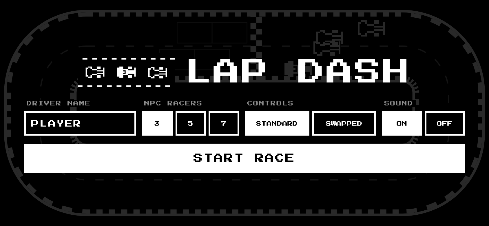

# Lap Dash



**Lap Dash** is a retro, black-and-white, top-down racing game where players race computer-controlled opponents across three increasingly difficult tracks. Designed for landscape phones, it combines 8-bit arcade style with simple touch and keyboard controls.

🔗 **[Play the Game](https://jherogr.github.io/lap-dash-game)**

---

## ✨ Key Features

* **Core Mechanic:** Race three laps from the back of the grid, avoiding walls and rival cars while managing your health.
* **Levels & Modes:** Choose from 3, 5, or 7 racers to compete on an easy rounded rectangle, moderate S-bend, or hard track with tight U-bays.
* **Custom Assets & Audio:** Pixel-art cars, 1-bit arcade sound effects, and the bundled Press Start 2P font.

---

## 🕹️ Controls

| Action | Keyboard / Mouse | Controller |
| :--- | :--- | :--- |
| **Move / Steer** | `A` `D` or Left / Right Arrow | Not supported |
| **Accelerate** | `W` or Up Arrow | Not supported |
| **Brake** | `S` or Down Arrow | Not supported |
| **Pause** | `P` / `Esc` | Not supported |

On phones, use the left and right steering buttons and the GAS / BRK pedal buttons. The menu can swap the control sides.

---

## 🛠️ Built With

* **Engine / Framework:** Plain HTML, CSS, JavaScript, and Canvas
* **Art:** Original pixel-art cars and 1-bit visual effects
* **Language:** JavaScript

---

## 🚀 Getting Started (For Developers)

Follow these steps to run or modify the project locally:

### Prerequisites

* Node.js
* npm
* Chromium / Playwright for browser tests and screenshots

### Installation

1. Clone the repository:

   ```bash
   git clone https://github.com/jherogr/lap-dash-game.git
   cd lap-dash-game
   ```

2. Install browser-test dependencies:

   ```bash
   npm install
   ```

3. Start the local server:

   ```bash
   npm start
   ```

4. Open `http://localhost:8080` in a landscape browser window.

### Build

The production build creates a single self-contained HTML file:

```bash
npm run build
```

The build is written to `dist/lap-dash.html`.

---

## 🗺️ Roadmap

- [x] Core movement and physics
- [x] Three tracks and NPC racer counts
- [x] Health, bumps, and respawning
- [x] Touch and keyboard controls
- [x] Countdown, pause, and finish screens
- [x] Single-file web build
- [ ] Additional tracks
- [ ] Controller support
- [ ] More character and vehicle customization

---

## 🧪 Tests

```bash
npm test             # Build dist/, then run engine and browser tests
npm run test:engine  # Engine tests only
npm run test:e2e     # Browser tests
npm run balance      # Win-rate table for scripted drivers
npm run screenshots  # Regenerate docs/screenshots/
```

The tests cover track geometry and road clearance, computer-driver lap completion, player bumps and respawning, health rules, menu and rotation behavior, countdown and HUD states, pause / restart / finish screens, phone layouts, and audio unlocking.

### Difficulty Balance

The table below uses carefully scripted, average, and sloppy bots over 40 races per cell:

| Track | Careful driver wins | Average driver wins | Sloppy driver wins |
| :--- | ---: | ---: | ---: |
| 3 racers (easy) | 100% | 73% | 10% |
| 5 racers (moderate) | 98% | 45% | 3% |
| 7 racers (hard) | 98% | 30% | 3% |

These are bots, not people, so real player win rates will differ. Opponent speed ranges are defined by `DIFFS` in `src/engine.js`.

---

## 🗂️ Project Layout

```text
index.html              page markup and dev entry
src/engine.js           DOM-free game rules
src/game.js             menu, HUD, controls, canvas, and audio
src/styles.css          responsive styling
assets/fonts/           bundled Press Start 2P font
scripts/build.js        creates the single-file distribution
scripts/serve.js        local static server
scripts/screenshots.js  screenshot generator
tests/engine.test.js    engine tests
tests/e2e.test.js       browser tests
tests/balance.js        win-rate simulation
tests/bots.js           scripted drivers
docs/screenshots/       game screenshots
```

The engine is deliberately DOM-free so it can be tested headlessly in Node.

---

## 🤝 Credits & License

* **Developed by:** jherogr
* **Font:** [Press Start 2P](https://fonts.google.com/specimen/Press+Start+2P) by CodeMan38, SIL Open Font License 1.1
* **Third-Party Assets:** None; the game uses its own pixel-art and 1-bit audio
* **License:** Distributed under the MIT License
