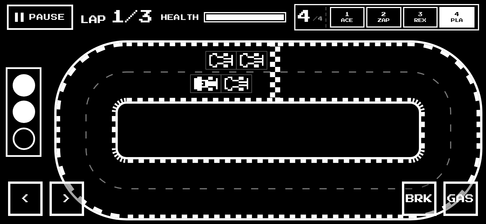
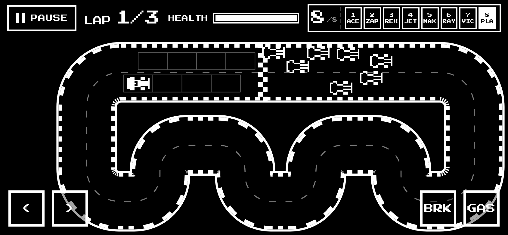

# Lap Dash

A retro, black-and-white, top-down racing game for phones, played sideways (landscape). Pong-style look, pixel-art cars, touch controls.
Plain HTML, CSS and JavaScript: no framework, no dependencies to play it.

| | | |
|---|---|---|
|  |  |  |

## Play

```bash
npm start            # serves the project on http://localhost:8080  (open it on a phone, landscape)
```

or open `index.html` directly, or `dist/lap-dash.html` (the whole game in one file, font included).

## How it plays

- **Menu:** driver name, **NPC racers (3 / 5 / 7)**, controls (standard or swapped sides), sound. A computer-only demo race runs behind the menu.
- **The NPC count picks the track and the opponents:** 3 = easy rounded rectangle, 5 = moderate S-bend, 7 = hard track with two tight U-bays.
- Every race is **3 laps**. You always start at the back of the grid. No map, no timer, no boosts or items.
- **Health bar:** every bump on a wall or another car costs health. At zero your car blows up and restarts in the same spot with full health. There is no game over; the race ends when you finish.
- Stoplight countdown on the left, with the third lamp flashing GO.
- **Landscape only.** On an upright phone the game asks you to turn it; turning the phone mid-race pauses the race.
- Touch: steer and pedal buttons (swappable sides). Keyboard: arrows or WASD, `P` / `Esc` to pause.
- 1-bit style arcade sounds: engine blips on buttons, GAS and BRK pedal sounds, explosion.

## Project layout

```
index.html              page markup (dev entry: loads src/*)
src/engine.js           game rules, no DOM: tracks, road geometry, cars, AI, bumps, laps, ranking
src/game.js             game shell: menu, HUD, controls, drawing (canvas), audio, demo race
src/styles.css          all styling (+ @font-face for the bundled font)
assets/fonts/           Press Start 2P (SIL Open Font License, see OFL.txt)
scripts/build.js        bundles everything into dist/lap-dash.html (single self-contained file)
scripts/serve.js        tiny static server for `npm start`
scripts/screenshots.js  regenerates docs/screenshots/
tests/engine.test.js    engine tests (Node only)
tests/e2e.test.js       browser tests (Playwright / Chromium)
tests/balance.js        win-rate simulation with scripted drivers
tests/bots.js           the scripted drivers
docs/screenshots/       screenshots
```

Why no framework: the game is one canvas plus a few screens, so React/Vue/etc. would add weight without helping.
The engine is deliberately DOM-free so it can be tested headlessly in Node.

## Tests

```bash
npm install          # only needed for the browser tests/screenshots (playwright)
npm test             # builds dist/, then runs engine + browser tests
npm run test:engine  # engine tests only (no dependencies)
npm run balance      # win-rate table for good / average / sloppy scripted drivers
npm run screenshots  # regenerate docs/screenshots
```

What is covered: track geometry round-trips and road clearance at several stretch factors, computer drivers finishing 3 laps on every track without
scraping walls, a parked player getting hit and respawning in place, health/bump rules, menu contents, portrait prompt and rotation pause,
demo race continuing when the racer count changes, countdown / HUD / controls / health bar, respawn, pause / restart / finish screens, HUD layout
on two phone sizes for every track, audio unlock; the browser tests run against both `index.html` and `dist/lap-dash.html`.

### Difficulty balance (scripted drivers, 40 races per cell)

| Track | Careful driver wins | Average driver wins | Sloppy driver wins |
|---|---|---|---|
| 3 racers (easy) | 100% | 73% | 10% |
| 5 racers (moderate) | 98% | 45% | 3% |
| 7 racers (hard) | 98% | 30% | 3% |

These are bots, not people: real win rates will differ. The opponents' speed range per track is `DIFFS` in `src/engine.js`.

## Screenshots

All in `docs/screenshots/` (taken at phone-landscape size with the bundled font): turn-your-phone prompt, menu (3 and 7 racers), stoplight countdown and GO,
the three tracks, health bar, explosion, pause, finish, and the mid-race rotation pause.

## Credits

Font: [Press Start 2P](https://fonts.google.com/specimen/Press+Start+2P) by CodeMan38, SIL Open Font License 1.1 (`assets/fonts/OFL.txt`).
